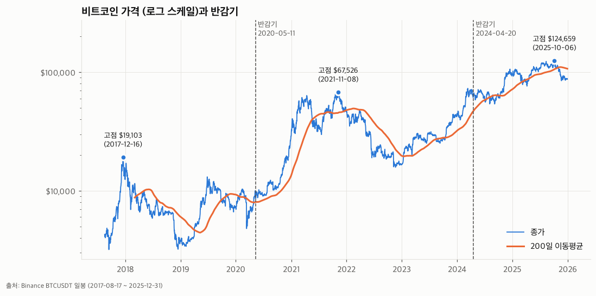
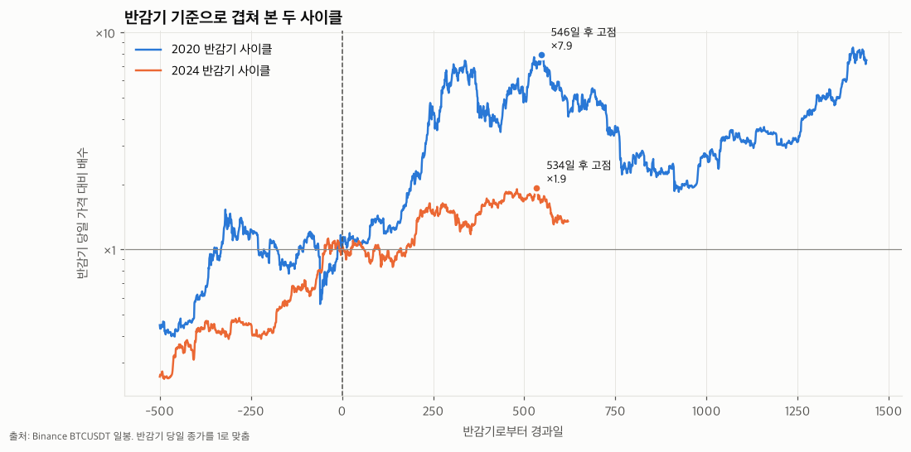
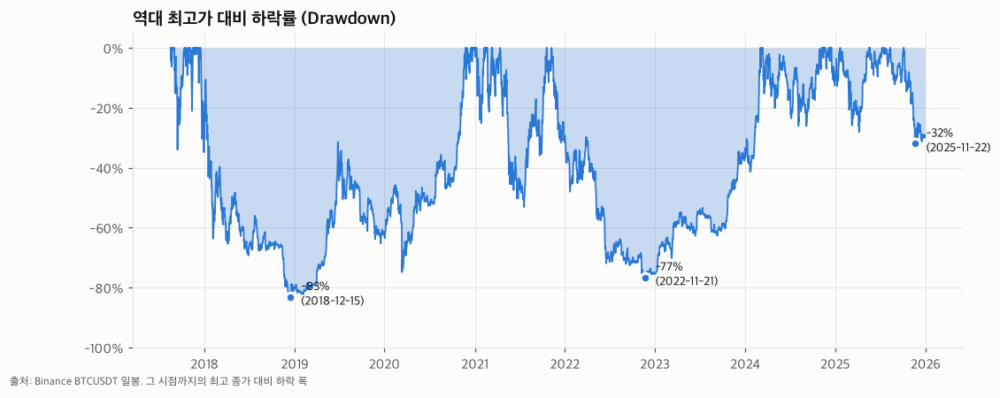
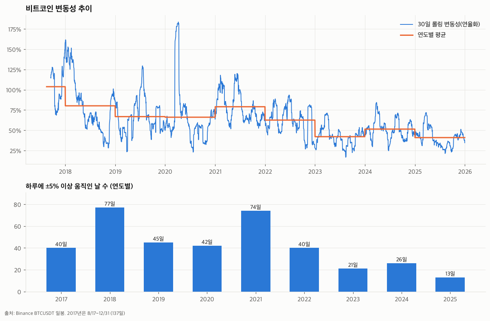
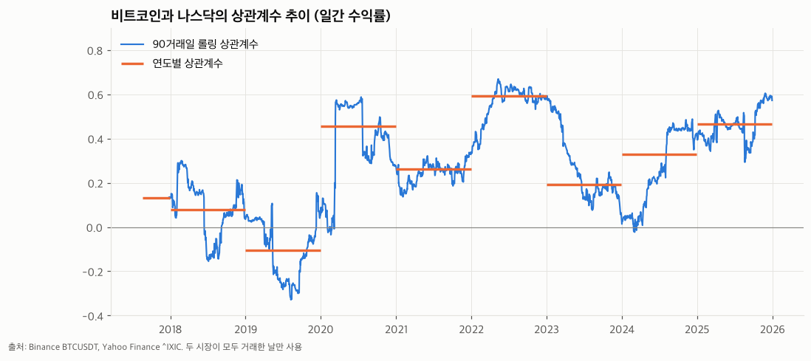
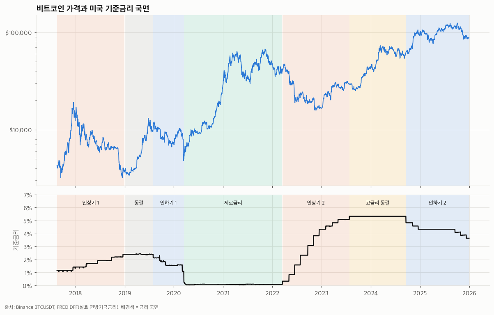
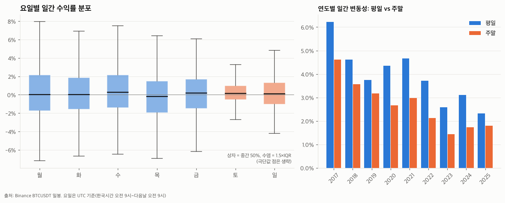
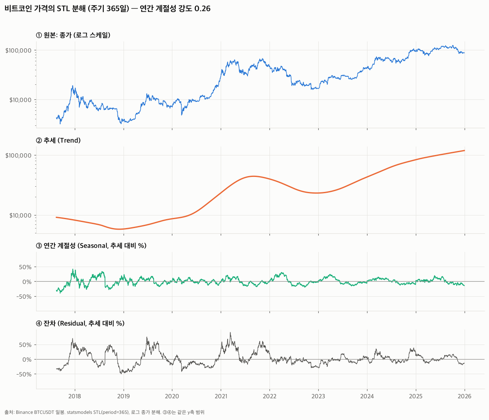

# 비트코인은 성숙한 자산이 되어가고 있는가?

> BTCUSDT 일봉(2017-08-17 ~ 2025-12-31) 시계열 분석 리포트

<!-- ✍️ = 직접 작성할 부분 -->

## 1. 분석 주제

### "성숙"의 정의
본 리포트에서 "성숙"은 다음 네 가지 변화를 의미한다.

1. 변동성과 극단적 가격 변동의 감소
2. 반감기 주기에 따른 폭등·폭락 폭의 축소
3. 주식시장 및 금리 등 거시 요인과의 연동 증가
4. 전통 금융시장의 거래 시간에 맞춘 거래 패턴

이는 분석을 위한 조작적 정의이며, 학술적으로 합의된 기준은 아니다. 또한 "성숙"은 가치 판단(좋다/나쁘다)이 아니라 "움직이는 방식이 바뀌었는가"를 중립적으로 보기 위한 틀이다.

## 2. 분석 질문

| # | 질문 | 대응하는 성숙 지표 |
|---|---|---|
| Q1 | 4년(반감기) 주기는 반복되는가? | 2 |
| Q2 | 변동성은 줄어들고 있는가? | 1 |
| Q3 | 외부 요인(나스닥, 금리)과 어떤 관계인가? | 3 |
| Q4 | 주말과 평일의 움직임이 다른가? | 4 |

## 3. 데이터 설명

| 데이터 | 출처 | 기간 | 행 수 | 용도 |
|---|---|---|---|---|
| BTCUSDT 일봉 | Binance 공개 API (`/api/v3/klines`) | 2017-08-17 ~ 2025-12-31 | 3,059 | 주 분석 대상 |
| 나스닥 종합지수 `^IXIC` | Yahoo Finance (`yfinance`) | 같은 기간 | 2,105 (거래일만) | Q3 비교 |
| 실효 연방기금금리 `DFF` | FRED (미국 세인트루이스 연준) | 같은 기간 | 3,059 (주말 포함) | Q3 비교 |

- 시작일 2017-08-17은 바이낸스 BTCUSDT 거래가 시작된 날이다.
- BTC 컬럼: `date, open, high, low, close, volume, quote_volume, trades`
- 일봉은 UTC 00:00 기준(한국시간 오전 9시)으로 하루가 나뉜다.
- USDT ≈ 1달러로 가정하고 BTCUSDT를 달러 가격으로 해석한다.

## 4. 데이터 정제

### 4-1. 결측치
- 빈 값 0개, 빠진 날짜 0일, 중복 날짜 0일 (`check_data.py`)
- 가격 논리 검사(고가 ≥ 저가, 종가가 [저가, 고가] 안, 가격 > 0) 모두 통과

### 4-2. 이상치
- **기준:** 일간 수익률의 z-score 절댓값이 3을 넘는 날을 이상치 후보로 표시 → **51일**
- **처리:** 삭제하지 않고 모두 유지
- **근거:**
  - 가격 논리 검사를 모두 통과해 기록 오류로 볼 근거가 없다.
  - 후보 날짜가 코로나 폭락(2020-03-12, -39.5%), FTX 파산(2022-11-09, -14.2%) 등 실제 시장 사건과 겹친다.
  - 본 분석의 목적이 변동성과 주요 사건을 보는 것이므로, 이상치를 지우면 분석 대상 자체가 사라진다.
  - 평균이 극단값에 끌려가는 것을 보완하기 위해 요일별 통계 등에서는 중앙값을 함께 제시한다.
- **한계:** 기간 전체의 표준편차 하나로 기준을 잡았기 때문에, 변동성이 컸던 초기(2017~2022)에 후보가 몰린다. 2023년 이후는 1일뿐이다.

### 4-3. 나스닥과 날짜 맞추기 (Q3)
비트코인은 365일, 나스닥은 평일에만 거래되므로 상관계수를 구하려면 날짜를 맞춰야 한다.

- **방법:** 두 시장이 모두 거래한 날짜의 **가격**을 먼저 맞춘 뒤 수익률을 계산했다 (공통 거래일 2,105일).
- **이유:** 이렇게 하면 월요일 수익률이 두 시장 모두 "금요일 종가 → 월요일 종가"가 되어, 비트코인의 주말 움직임이 버려지지 않고 월요일 수익률에 포함된다.
  - ❌ 수익률을 먼저 계산하고 주말 행을 지우면, BTC는 "일→월", 나스닥은 "금→월"을 비교하게 되어 기간이 어긋난다.
  - ❌ 나스닥 주말 값을 금요일 값으로 채우면 주말마다 나스닥 수익률이 가짜 0%가 되어 상관계수가 낮게 왜곡된다.
- **보조 검증:** 주간 수익률(금요일 종가 기준)로도 상관계수를 계산해 일간 결과와 방향이 같은지 확인했다.
- **비트코인 원본 데이터는 그대로 두고,** 이 정렬은 Q3의 나스닥 비교에만 사용한다. Q4(주말 vs 평일)는 365일 데이터를 그대로 쓴다.
- **한계:** 바이낸스 일봉은 UTC 00:00에, 나스닥은 미 동부 16:00(UTC 20~21시)에 마감되어 같은 날짜라도 3~4시간 차이가 있다.

### 4-4. 금리 국면 구분 (Q3)
기준금리는 계단식으로 바뀌어 일간 수익률과 직접 상관계수를 구하는 것이 의미가 없으므로, FOMC 결정일 기준으로 7개 국면으로 나눠 구간별 통계를 비교했다.

| 국면 | 기간 |
|---|---|
| 인상기 1 | 2017-08-17 ~ 2018-12-31 |
| 동결 | 2019-01-01 ~ 2019-07-31 |
| 인하기 1 | 2019-08-01 ~ 2020-03-15 |
| 제로금리 | 2020-03-16 ~ 2022-03-16 |
| 인상기 2 | 2022-03-17 ~ 2023-07-26 |
| 고금리 동결 | 2023-07-27 ~ 2024-09-17 |
| 인하기 2 | 2024-09-18 ~ 2025-12-31 |

## 5. 적용한 시계열 분석 기법

| 기법 | 사용한 곳 |
|---|---|
| 이동평균 (200일) | Q1 장기 추세 |
| 구간별 통계 (반감기 사이클, 금리 국면) | Q1, Q3 |
| 고점 대비 하락률 (drawdown) | Q1 |
| 변화율 (일간 수익률) | 전체 |
| 롤링 표준편차 (30일, 연율화) | Q2 |
| 롤링 상관계수 (90거래일) | Q3 |
| 연도별·요일별 집계 | Q2, Q4 |

## 6. 시각화와 인사이트

<!-- 각 질문마다 "관찰(수치/근거)"과 "해석(가설)"을 구분해서 쓴다 -->

### Q1. 4년 주기는 반복되는가?





**관찰**

| 반감기 | 사이클 고점 | 반감기→고점 | 고점 후 저점 | 하락률 | 고점→저점 |
|---|---|---|---|---|---|
| 2016-07-09 | 2017-12-16 $19,103 | 525일 | 2018-12-15 $3,212 | -83.2% | 364일 |
| 2020-05-11 | 2021-11-08 $67,526 | 546일 | 2022-11-21 $15,781 | -76.6% | 378일 |
| 2024-04-20 | 2025-10-06 $124,659 | 534일 | 2025-11-22 $84,740 (진행 중) | -32.0% | 47일 |

- 반감기 당일 가격 대비 고점 배수: 2020 사이클 7.9배 → 2024 사이클 1.9배
- 사이클 고점 = 반감기 후 730일 이내 최고 종가로 정의

**해석** ✍️

### Q2. 변동성은 줄어들고 있는가?



**관찰**

| 연도 | 연율화 변동성 | ±5% 이상 움직인 날 | 이상치 후보 |
|---|---|---|---|
| 2017* | 110.6% | 40일 | 10일 |
| 2018 | 83.1% | 77일 | 12일 |
| 2019 | 68.6% | 45일 | 8일 |
| 2020 | 75.5% | 42일 | 7일 |
| 2021 | 81.1% | 74일 | 8일 |
| 2022 | 63.7% | 40일 | 5일 |
| 2023 | 44.1% | 21일 | 0일 |
| 2024 | 53.1% | 26일 | 1일 |
| 2025 | 41.7% | 13일 | 0일 |

\* 2017년은 8/17 ~ 12/31 (137일)

**해석** ✍️

### Q3. 외부 요인(나스닥, 금리)과 어떤 관계인가?




**관찰 - 나스닥**
- 전체 기간 일간 수익률 상관계수: 0.29

| 연도 | 2017 | 2018 | 2019 | 2020 | 2021 | 2022 | 2023 | 2024 | 2025 |
|---|---|---|---|---|---|---|---|---|---|
| 일간 | 0.13 | 0.08 | -0.10 | 0.46 | 0.26 | 0.59 | 0.19 | 0.33 | 0.47 |
| 주간 (보조) | -0.02 | 0.04 | -0.05 | 0.33 | 0.20 | 0.43 | 0.26 | 0.08 | 0.41 |

**관찰 - 금리 국면**

| 국면 | 평균 금리 | BTC 기간 수익률 | BTC 연율화 변동성 | 나스닥 상관계수 |
|---|---|---|---|---|
| 인상기 1 | 1.66% | -13.6% | 91.9% | 0.09 |
| 동결 | 2.40% | +165.5% | 73.2% | -0.15 |
| 인하기 1 | 1.71% | -48.3% | 81.0% | 0.42 |
| 제로금리 | 0.08% | +717.5% | 73.4% | 0.32 |
| 인상기 2 | 3.23% | -28.3% | 56.3% | 0.51 |
| 고금리 동결 | 5.33% | +106.4% | 49.9% | 0.26 |
| 인하기 2 | 4.32% | +41.9% | 43.1% | 0.43 |

**해석** ✍️

### Q4. 주말과 평일의 움직임이 다른가?



**관찰**

| 요일 | 월 | 화 | 수 | 목 | 금 | 토 | 일 |
|---|---|---|---|---|---|---|---|
| 평균(%) | 0.39 | 0.03 | 0.45 | -0.21 | 0.25 | 0.16 | 0.07 |
| 중앙값(%) | 0.04 | 0.01 | 0.27 | -0.19 | 0.17 | 0.13 | 0.08 |
| 표준편차(%) | 4.09 | 3.53 | 3.72 | 4.35 | 3.68 | 2.44 | 2.86 |

| 연도 | 2017 | 2018 | 2019 | 2020 | 2021 | 2022 | 2023 | 2024 | 2025 |
|---|---|---|---|---|---|---|---|---|---|
| 주말/평일 변동성 비율 | 0.74 | 0.77 | 0.84 | 0.61 | 0.64 | 0.57 | 0.55 | 0.56 | 0.77 |

**해석** ✍️

## 7. 보너스

### 7-1. 시계열 분해 (STL)



**방법**
- `statsmodels`의 STL로 **로그 종가**를 추세, 연간 계절성(주기 365일), 잔차로 분해했다 (`decompose.py`).
- 로그를 쓴 이유: 가격이 수십 배 변하므로, 로그에서 분해해야 계절 성분을 "추세 대비 몇 %"로 읽을 수 있다.
- 계절성 강도 F_s = max(0, 1 − Var(잔차) / Var(계절 + 잔차))로 수치화했다. 0이면 계절성이 없고 1이면 강하다.

**관찰**
- 추세 강도 F_t = 0.95, 계절성 강도 F_s = 0.26
- 설정을 바꿨을 때의 계절성 강도 (민감도 확인)

  | 설정 | F_s |
  |---|---|
  | 기본값 | 0.26 |
  | 추세 창 367일 (짧게) | 0.35 |
  | 계절 패턴 고정 (매년 같은 모양) | 0.13 |

- 잔차 표준편차 23.1%가 계절 성분 표준편차 11.4%의 약 2배다.
- 연간 계절 성분의 월별 평균: 4~5월이 가장 높고(+7.1%, +9.0%), 9~10월이 가장 낮다(-14.0%, -9.6%).
- 교차 확인 (달력 월별 수익률, 표본 8~9년):

  | 월 | 1 | 2 | 3 | 4 | 5 | 6 | 7 | 8 | 9 | 10 | 11 | 12 |
  |---|---|---|---|---|---|---|---|---|---|---|---|---|
  | 평균(%) | 5.7 | 9.6 | 2.9 | 10.1 | 2.0 | -3.4 | 10.0 | -4.8 | -3.0 | 18.1 | 5.1 | 6.3 |
  | 중앙값(%) | 5.1 | 5.7 | 6.5 | 8.4 | 1.3 | -4.6 | 12.4 | -7.6 | -5.5 | 11.0 | -7.1 | -3.0 |
  | 상승한 해 비율(%) | 62.5 | 75.0 | 62.5 | 62.5 | 50.0 | 37.5 | 75.0 | 25.0 | 33.3 | 77.8 | 44.4 | 33.3 |

**분석 과정에서의 판단**
- 처음에는 `robust=True`(극단값의 가중치를 낮추는 옵션)로 분해했다. 그런데 계절 성분이 -69% ~ +167%로 크게 움직이는데도 계절성 강도가 0으로 나오는 모순이 생겼다.
- 확인해보니 계절 성분과 잔차가 서로 반대로 움직이며 상쇄되고 있었다(상관 -0.46). 그래서 기본값(`robust=False`)으로 바꿨다.
- 주기 7일(요일) 분해도 시도했지만, Q4의 요일별 직접 집계와 맞지 않는 값이 나와서 채택하지 않았다.

**해석** ✍️

### 7-2. 대시보드
- Streamlit 대시보드(`dashboard.py`)로 기간, 이동평균, 롤링 창, 이상치 표시를 바꿔가며 Q1~Q4를 탐색할 수 있다.
- 실행 방법과 스크린샷, 필터 변경 시나리오: [docs/DASHBOARD.md](docs/DASHBOARD.md)

## 8. 결론 ✍️

## 9. 한계점 ✍️
<!-- 지금까지 나온 후보 (직접 판단해서 고르고 다듬기)
- 반감기 사이클 표본이 2~3개뿐
- 제로금리 시기와 반감기 상승장이 겹쳐 금리 효과와 주기 효과를 분리할 수 없음
- 상관관계일 뿐 인과관계가 아님
- 이상치 기준(전체 기간 표준편차 하나)이 초기 구간에 유리하게 작동
- 사이클 고점 탐색 범위(730일)는 분석자가 정한 값
- 마감 시각 차이 (UTC 00:00 vs 미 동부 16:00)
- USDT ≈ 1달러 가정
- 단일 거래소(바이낸스) 데이터
- STL 계절성 강도가 설정에 따라 0.13~0.35로 달라짐, 월별 표본이 8~9년뿐
-->

## 10. 실행 방법

```bash
python3.12 -m venv .venv
.venv/bin/pip install -r requirements.txt
.venv/bin/python collect_data.py   # 데이터 수집 → data/
.venv/bin/python check_data.py     # 결측치·이상치 점검
.venv/bin/python analyze.py        # 분석 수치 출력 + 그래프 → images/
.venv/bin/python decompose.py      # [보너스] STL 분해 → images/fig8
.venv/bin/streamlit run dashboard.py  # [보너스] 대시보드 → http://localhost:8501
```

## 11. AI 사용 로그

사용 도구: Claude Code (Anthropic Claude). 대화하면서 코드 작성, 실행, 수치 확인을 함께 진행했다.

### 11-1. 작업별 사용 내역

| 작업 | 사용 이유 | 검증 방법 |
|---|---|---|
| **과제 이해, 데이터 선정 상담** (BTC-USD, USDT, BTCUSDT 비교) | 데이터별 장단점을 빠르게 비교하기 위해 (대안 탐색) | AI가 USDT(스테이블코인)를 추천 후보로 설명했지만, 내가 원한 것은 BTCUSDT 페어였다. 질문을 다시 해서 바로잡았다. |
| **데이터 수집 코드** (`collect_data.py`) | 바이낸스 API 페이지 나눠 받기, yfinance, FRED 사용법을 찾는 시간을 줄이기 위해 | 받은 행 수(3,059)가 2017-08-17 ~ 2025-12-31의 달력 일수와 정확히 같은지 확인했다 (윤년 2020, 2024 포함). |
| **데이터 점검 코드** (`check_data.py`) | 결측치, 빠진 날짜, 가격 논리 오류를 빠짐없이 확인하기 위해 | 빈 값뿐 아니라 "날짜 자체가 빠진 경우"와 "고가 < 저가" 같은 논리 오류까지 따로 검사했다. |
| **이상치 처리 기준 상담** | 지울지 남길지 판단할 기준을 세우기 위해 | AI는 기준(기록 오류인가 / 분석 목적에 필요한가)만 제시했고, **51일 모두 유지는 내가 결정했다.** |
| **분석 질문 구성** | 질문끼리 이어지는 구조를 잡기 위해 | "4년 주기"와 "금리" 질문은 내가 제안했고, AI가 나머지를 보완해 "성숙"이라는 주제로 묶었다. "성숙"의 뜻이 모호해서 다시 물어보고, 측정 가능한 정의 4가지로 구체화했다. |
| **나스닥 날짜 맞추기 방법** | 주말이 없는 데이터와 정렬하는 올바른 방법을 확인하기 위해 | "가격 먼저 정렬 → 수익률 계산"과 "수익률 먼저 → 주말 삭제"를 비교해 이유를 이해했다. 주간 수익률로도 상관계수를 다시 계산해 방향이 같은지 확인했다 (보조 검증). |
| **분석, 시각화 코드** (`analyze.py`) | 그래프 7개와 통계를 빠르게 만들기 위해 (시간 절감) | 2020 반감기 사이클의 고점이 **2024-03-13로 잘못 잡힌 오류**를 발견했다. 2021년 11월이 고점이라는 사실과 대조해서 찾았고, 고점 탐색 범위를 반감기 후 730일로 제한해 고쳤다. 그래프를 모두 열어 라벨 겹침과 축 표시도 확인했다. |
| **시계열 분해** (`decompose.py`) | STL 사용법과 결과 해석 방법을 익히기 위해 | 처음 결과(`robust=True`)에서 "계절 성분은 크게 움직이는데 계절성 강도는 0"이라는 **모순**을 발견했다. 설정 12가지를 비교해 원인(계절과 잔차의 상쇄)을 찾고 기본값으로 바꿨다. 달력 월별 수익률을 직접 집계해 교차 확인했다. |
| **대시보드** (`dashboard.py`) | Streamlit, Plotly 코드를 빠르게 작성하기 위해 | 실제로 실행해서 필터(기간, 롤링 창, 집계 방식)를 바꿔보고, 상단 수치 카드가 바뀌는지 확인했다 (예: 2022년 이후로 좁히면 이상치 51일 → 6일). |
| **README, 리포트 틀 정리** | 문서 구조를 잡고 문장을 다듬기 위해 | 리포트의 관찰 수치를 스크립트 출력값과 대조했다. |

### 11-2. AI 도움 없이 내가 판단한 것
<!-- ✍️ 직접 작성: 해석, 결론, 한계점을 어떻게 썼는지, AI 의견과 다르게 판단한 부분이 있다면 무엇인지 -->

### 11-3. 내가 직접 해본 추가 검증
<!-- ✍️ 직접 해보고 결과 적기. 예시:
- 바이낸스 웹사이트나 CoinMarketCap에서 2021-11-08, 2022-11-21 종가를 찾아 CSV 값과 비교
- data/btcusdt_1d.csv를 엑셀로 열어 특정 연도의 일간 수익률 표준편차를 직접 계산해 Q2 표와 비교
- 이상치 상위 5일의 날짜를 뉴스에서 검색해 실제 사건과 대조
-->

> AI가 작성한 코드와 수치는 위와 같이 검증했으며, 최종 해석과 결론은 본인이 근거를 들어 작성했다.
