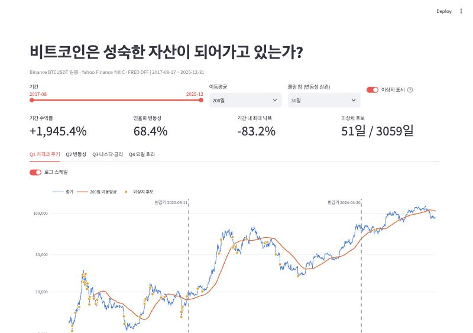
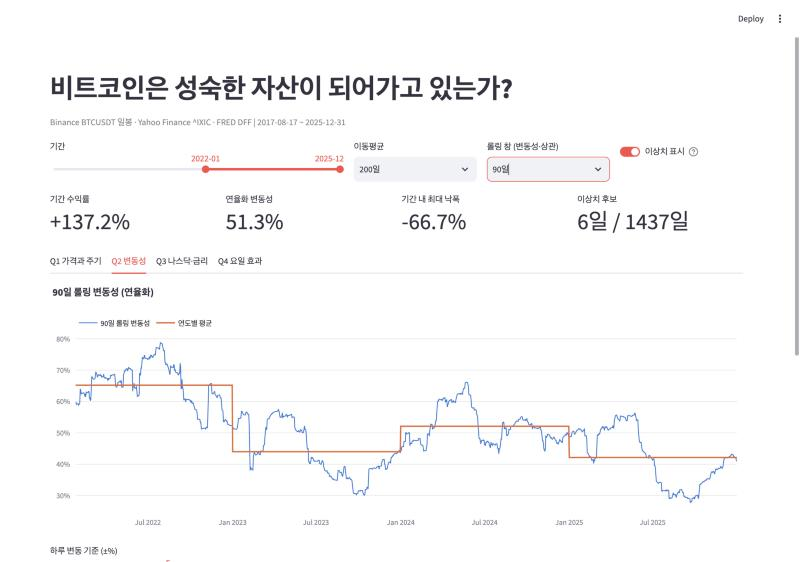
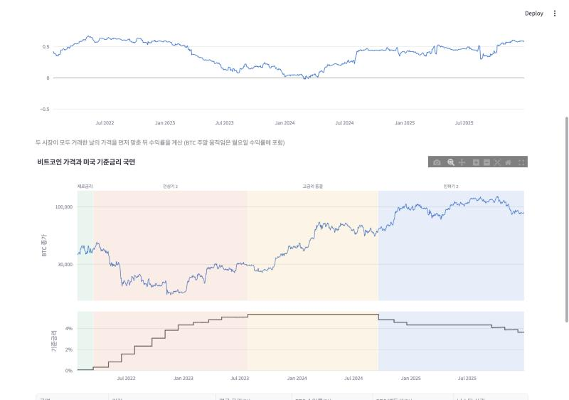
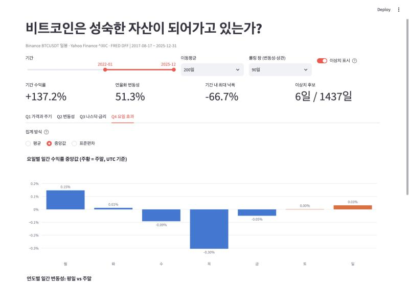

# 대시보드 실행 방법과 탐색 시나리오

> 보너스 과제 1 제출 방식: **(3) 대시보드 스크린샷 세트 + 필터/기간 변경 시나리오 설명**

## 실행 방법

```bash
# 1) 가상환경과 라이브러리 (처음 한 번)
python3.12 -m venv .venv
.venv/bin/pip install -r requirements.txt

# 2) 데이터 수집 (data/ 가 비어 있을 때)
.venv/bin/python collect_data.py

# 3) 대시보드 실행 → 브라우저에서 http://localhost:8501
.venv/bin/streamlit run dashboard.py
```

## 화면 구성

| 영역 | 내용 |
|---|---|
| 필터 (상단 한 줄) | **기간** 슬라이더, **이동평균** 일수(50/100/200/365), **롤링 창**(30/60/90/180일, 변동성·상관계수에 공통 적용), **이상치 표시** 켜기/끄기 |
| 핵심 수치 카드 | 선택 기간의 수익률, 연율화 변동성, 최대 낙폭, 이상치 후보 수 |
| Q1 가격과 주기 | 종가 + 이동평균 + 반감기 선 + 이상치 점, 로그/선형 전환, 고점 대비 하락률 |
| Q2 변동성 | 롤링 변동성과 연도별 평균, "하루 ±N% 이상 움직인 날" (N을 슬라이더로 조절) |
| Q3 나스닥·금리 | 나스닥과의 롤링 상관계수, 가격·기준금리 위아래 패널 + 금리 국면 배경색, 국면별 통계 표 |
| Q4 요일 효과 | 요일별 수익률 (평균/중앙값/표준편차 전환), 연도별 평일 vs 주말 변동성 |

- 모든 그래프는 마우스를 올리면 값이 표시된다.
- 이동평균과 롤링 값은 **선택 기간 이전 데이터까지 써서 계산한 뒤** 기간에 맞춰 자른다. 그래서 기간을 좁혀도 그래프 앞부분이 비지 않는다.

## 탐색 시나리오

### ① 기본 화면: 전체 기간 (2017-08 ~ 2025-12)


- **필터:** 기간 전체, 이동평균 200일, 롤링 30일, 이상치 표시 ON
- **수치:** 기간 수익률 +1,945.4%, 연율화 변동성 68.4%, 최대 낙폭 -83.2%, 이상치 후보 51일
- **확인할 점:** 노란 이상치 점이 2017~2022년에 몰려 있고, 2023년 이후로는 거의 보이지 않는다.

### ② 기간을 2022-01 ~ 2025-12로 좁히고, Q2 변동성 탭에서 롤링 창을 30일 → 90일로 변경


- **필터 변경:** 기간 시작 2017-08 → 2022-01, 롤링 창 30일 → 90일
- **수치 변화:** 기간 수익률 +137.2%, 연율화 변동성 68.4% → **51.3%**, 최대 낙폭 -83.2% → **-66.7%**, 이상치 후보 51일 → **6일**
- **확인할 점:**
  - 롤링 창을 90일로 늘리면 단기 출렁임이 줄어 큰 흐름이 잘 보인다.
  - 연도별 평균선은 2022년 약 65% → 2023년 약 44% → 2024년 약 52% → 2025년 약 42%로 움직인다.

### ③ 같은 기간, Q3 나스닥·금리 탭


- **필터:** 기간 2022-01 ~ 2025-12, 롤링 90일
- **확인할 점:**
  - 나스닥과의 90일 상관계수가 2022년(인상기 2)에는 약 0.6으로 높게 유지되다가, 2024년 초에는 0 근처까지 내려간다. 2025년 말에는 다시 0.6 수준으로 올라간다.
  - 아래 패널에서 금리 인상기 2 → 고금리 동결 → 인하기 2로 이어지는 흐름과 가격을 함께 볼 수 있다.

### ④ 같은 기간, Q4 요일 효과 탭에서 집계 방식을 "중앙값"으로 변경


- **필터:** 기간 2022-01 ~ 2025-12, 집계 방식 평균 → **중앙값**
- **확인할 점:**
  - 이 기간 요일별 중앙값은 월요일 +0.15%가 가장 높고, 목요일 -0.30%가 가장 낮다. 주말(토 0.00%, 일 +0.03%)은 0에 가깝다.
  - 집계 방식을 평균으로 바꾸면 극단값 영향으로 값이 달라진다. 그래서 두 가지를 함께 보는 것이 좋다.

## 직접 해볼 만한 다른 시나리오
- 기간을 **각 반감기 전후 2년씩** 잘라서 Q1 화면을 비교해보기
- Q2의 "하루 변동 기준"을 5% → 10%로 올려서 극단적인 날이 어느 해에 몰리는지 보기
- 롤링 창을 30일 ↔ 180일로 바꿔서 나스닥 상관계수가 얼마나 달라지는지 확인하기 (창이 짧을수록 노이즈가 커짐)
